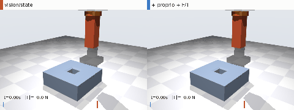
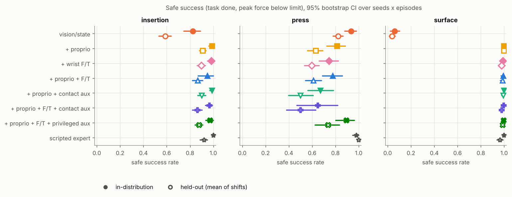
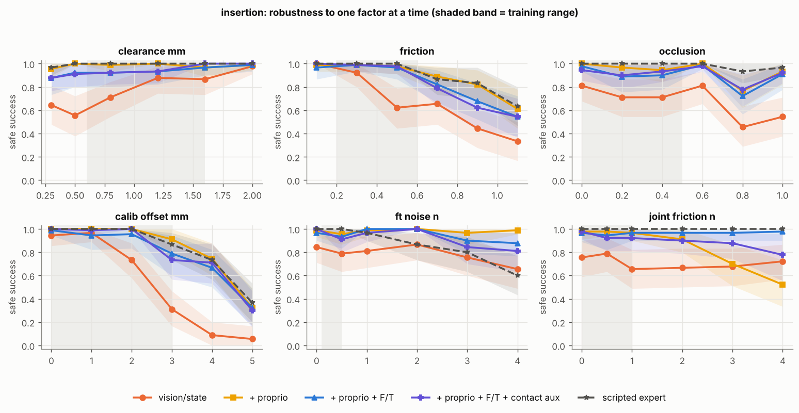

# Contact-aware manipulation benchmark

A small, controlled study of one question: **when does force or proprioceptive feedback improve a learned manipulation policy compared with vision alone, and how does that change under contact uncertainty?**

The repository contains three contact-rich MuJoCo tasks (peg insertion, press-to-depth, surface following), scripted demonstrators, a trajectory logger with a documented schema, one temporal Transformer policy trained under seven sensing conditions with identical capacity and budget, and an evaluation suite with held-out physical shifts, one-factor robustness sweeps, force-transient metrics and a failure taxonomy. Everything from data collection to figures runs from one command.



*Same episode, two policies. Left: vision/state only. Right: + proprioception + wrist F/T. The bar shows the current wrist force, the red tick the 25 N damage limit.*

## Results in brief

Safe success = task completed without exceeding the force limit. Mean over 3 training seeds; held-out = mean over 5 to 6 shifted physical conditions. Full tables with 95 % intervals are in [results/RESULTS_TABLES.md](results/RESULTS_TABLES.md); the write-up is [docs/REPORT.md](docs/REPORT.md).

| condition | insertion ID / held-out | press ID / held-out | surface ID / held-out |
|---|---|---|---|
| vision/state | 0.82 / 0.59 | **0.93 / 0.82** | 0.06 / 0.04 |
| + proprioception | **0.99 / 0.91** | 0.81 / 0.63 | **1.00 / 1.00** |
| + wrist F/T | 0.98 / 0.90 | 0.75 / 0.60 | 0.99 / 0.98 |
| + proprio + F/T | 0.95 / 0.87 | 0.78 / 0.61 | 0.99 / 0.99 |
| + proprio + contact-prediction aux | 0.99 / 0.90 | 0.67 / 0.50 | 1.00 / 0.99 |
| + proprio + F/T + contact-prediction aux | 0.97 / 0.87 | 0.65 / 0.50 | 1.00 / 0.98 |
| + proprio + F/T + privileged aux | 0.97 / 0.88 | 0.89 / 0.74 | 1.00 / 0.99 |
| scripted expert (reference) | 1.00 / 0.92 | 0.98 / 1.00 | 1.00 / 0.96 |

What the numbers say:

1. **Force matters where vision cannot resolve the contact state.** With good calibration and loose fits, vision/state is as good as anything else on insertion. With 3 mm of calibration error it drops to 0.31 while force-aware policies stay at 0.73 to 0.91. Surface following is close to impossible without force.
2. **Force-blind policies that succeed tend to push harder.** On insertion vision/state completes 96 % of episodes, but 31 % exceed the force limit (median peak 14 N vs 6 to 7 N with force).
3. **Joint efforts can stand in for a wrist sensor, up to a point.** Proprioception alone matches the wrist sensor on insertion and surface following, and the wrist sensor adds nothing on top. With 3 to 4 N of unmodelled joint friction, the proprioception-only policy degrades (0.98 to 0.52) while the wrist-sensor policies do not; with heavy wrist-sensor noise it is the other way round.
4. **Force inputs can teach a shortcut.** On press-to-depth, force-aware policies learned to stop at a force level instead of a depth, which works for mid-range button stiffness and fails badly outside it. Vision/state, which cannot take that shortcut, generalises better. A longer history that keeps the touch point in view does not fix it, so the cause is the demonstration data, not memory.
5. **A self-supervised contact-prediction loss did not help on average** at this model size. Privileged auxiliary labels that encode the task phase did help on press, which suggests the content of the auxiliary target is what matters.
6. **More data does not replace the sensor.** Force-aware insertion policies reach their ceiling with 25 demonstrations; vision/state with 360 is still well below them.





## Experimental design

* **One network, seven conditions.** A 2-layer causal Transformer over a 0.8 s observation history (128k parameters). Conditions differ only in which observation groups are zeroed and whether an auxiliary loss is active, so parameter count, optimiser and number of updates are identical (enforced by a unit test).
* **Non-privileged demonstrations.** Scripted experts read the same noisy observations as the full-sensor policy, with DART noise injection.
* **Controlled shifts.** Nuisances (camera calibration offset, occlusion, sensor noise, motor torque-constant error, joint friction, contact friction, clearance, fixture and contact stiffness, button stiffness, surface shape) are drawn per episode. Held-out sets move one physical cause outside the training range; sweeps pin one factor at six levels.
* **Paired evaluation.** Every condition and seed is evaluated on the same episodes (common random numbers). Differences are bootstrapped over seeds and episodes.
* **Metrics beyond success.** Peak force at 1 kHz, contact impulse, force overshoot after first contact, time to success, and a per-task failure taxonomy (miss, off target, misaligned, jammed, partial, excessive force, under/over-press, lost contact, out-of-band force).

The protocol was written down before the main runs: [docs/PROTOCOL.md](docs/PROTOCOL.md). The dataset and sensor models are described in [docs/DATA_CARD.md](docs/DATA_CARD.md).

## Quick start

```bash
pip install -e ".[dev]"
make test        # unit tests (environments, model capacity, labels, statistics)
make smoke       # two-minute end-to-end run on a tiny configuration
```

Reproduce everything (about 7 hours on 2 CPU cores; it parallelises across cores):

```bash
bash scripts/run_full.sh
# or step by step
make data main sample-efficiency press-memory report videos
```

On a cluster, `scripts/slurm_job.sh` runs the larger `configs/full.yaml` (5 seeds, bigger model, twice the evaluation episodes). Runs are resumable: finished jobs are skipped.

Offscreen rendering for videos needs EGL or OSMesa (`MUJOCO_GL=egl` or `MUJOCO_GL=osmesa`).

## Repository layout

```
cambench/
  envs/          base.py (robot, sensors, perception model), insertion.py, press.py, surface.py, nuisance.py
  experts/       scripted demonstrators
  data/          schema.py (trajectory schema), collect.py (DART collection), dataset.py (windows, auxiliary labels)
  models/        policy.py (temporal Transformer with modality masking, condition definitions)
  training/      train.py (fixed-budget behaviour cloning)
  evaluation/    rollout.py (batched paired rollouts), suite.py (evaluation sets)
  analysis/      stats.py (hierarchical bootstrap, paired differences), report.py (figures and tables)
configs/         main.yaml, sample_efficiency.yaml, press_memory.yaml, smoke.yaml, full.yaml
scripts/         collect.py, run_experiments.py, make_videos.py, run_full.sh, slurm_job.sh
docs/            PROTOCOL.md, DATA_CARD.md, REPORT.md
results/         per-episode CSVs, generated tables, figures/, videos/
tests/
```

## Limitations

This is a simulation study with a 3-DoF Cartesian robot, MuJoCo soft contacts, analytic sensor noise and a simulated pose estimator instead of images. It is meant to isolate what different sensing channels contribute under controlled shifts, not to predict real-robot success rates. The report discusses what would change on an articulated arm with real actuators.

## Author

Maria (Anh Duong Vo), anhduongvo.m@gmail.com

MIT license.
