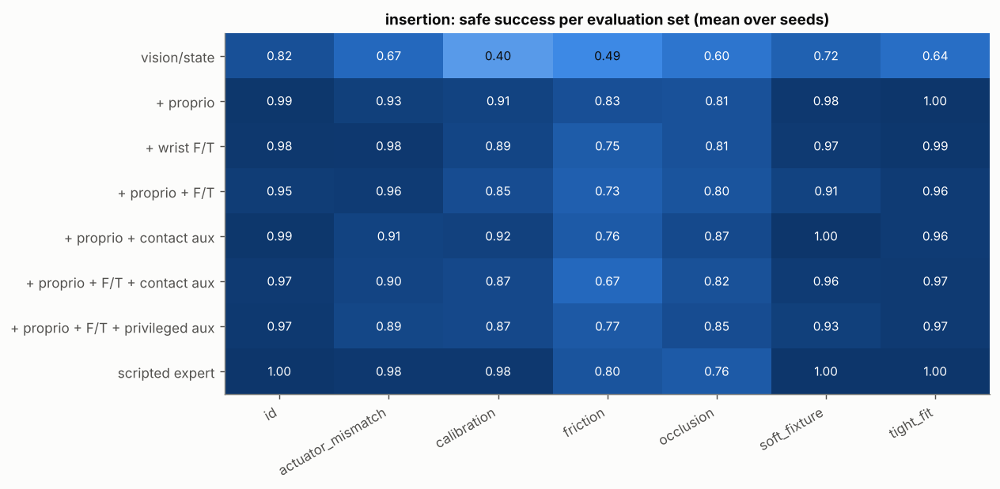
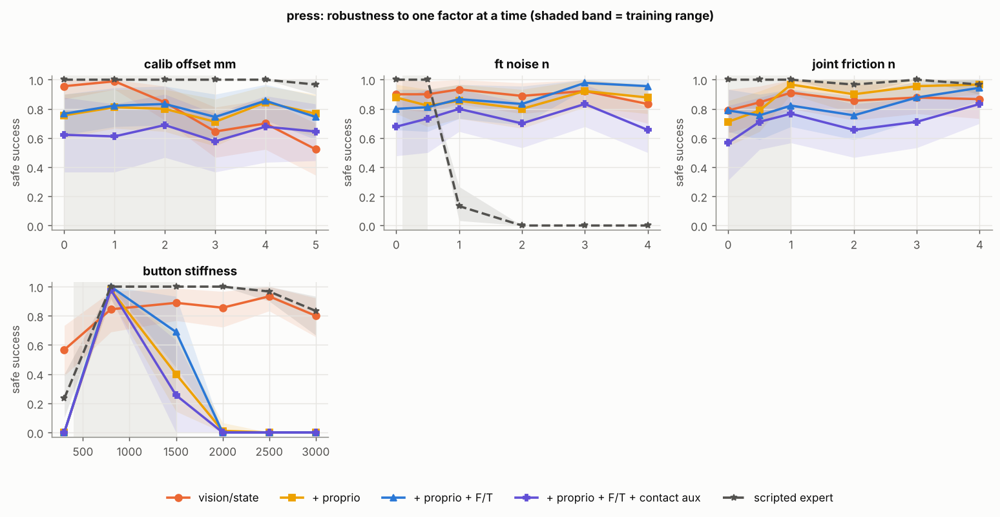
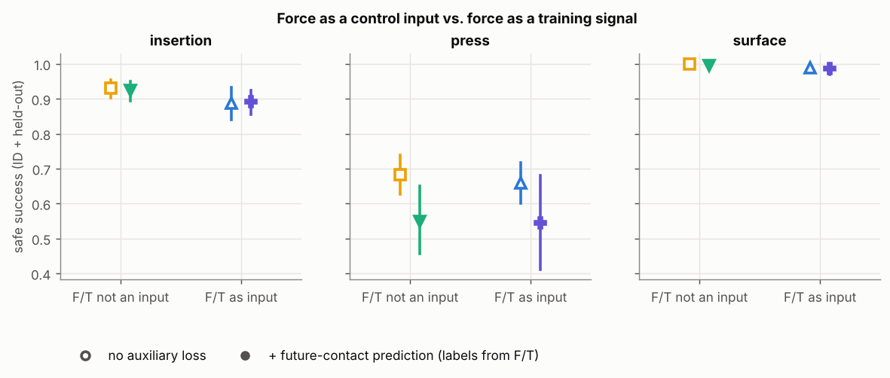
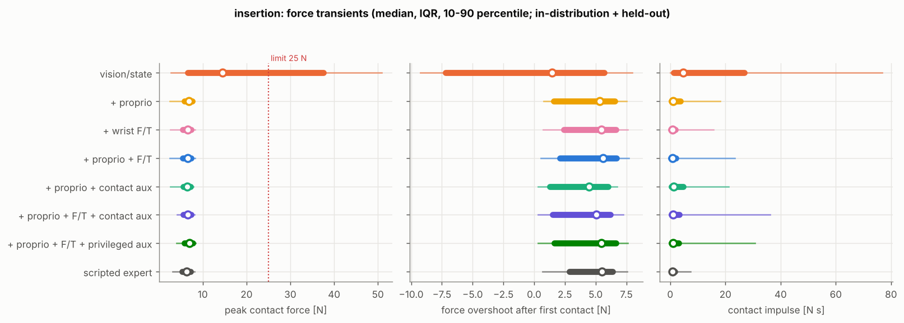
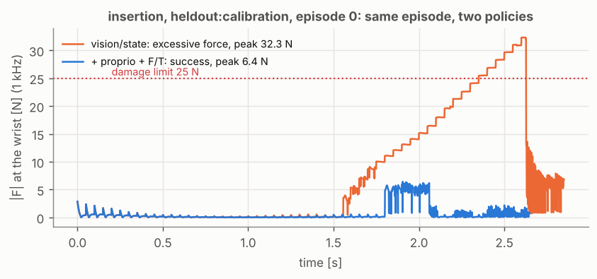
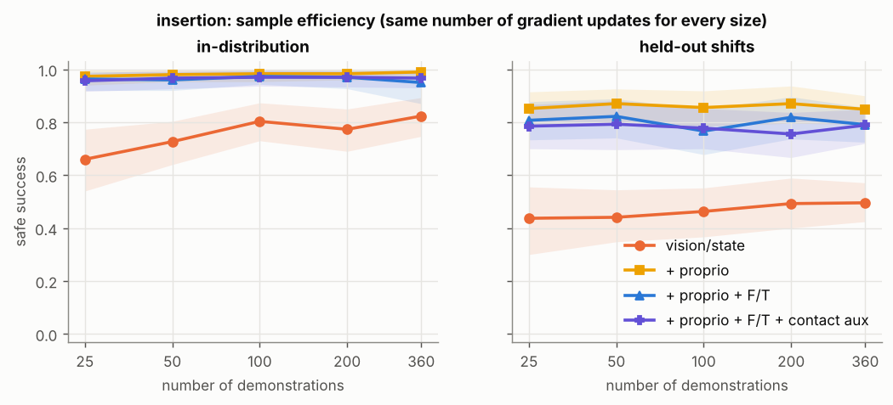
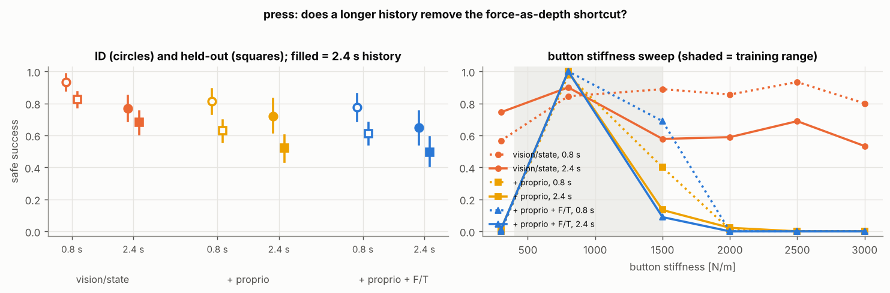

# When does force sensing help a learned manipulation policy?

Research report for the contact-aware manipulation benchmark. All numbers come from `results/RESULTS_TABLES.md`, which `cambench/analysis/report.py` generates from the per-episode evaluation logs. Intervals are 95 % hierarchical bootstrap intervals (training seeds, then shared evaluation episodes). Setup and analysis plan are in [PROTOCOL.md](PROTOCOL.md), the dataset in [DATA_CARD.md](DATA_CARD.md).

## Summary

I trained the same small temporal Transformer with behaviour cloning under seven sensing and representation conditions, on three simulated contact-rich tasks, and evaluated each policy on the same set of episodes (about 1,500 for insertion, 1,100 for press and 800 for surface following, covering in-distribution, held-out physical shifts and one-factor sweeps), with 3 training seeds per condition. In total that is 63 trained policies and 73,000 evaluation episodes for the main comparison, plus 57 policies for two follow-ups (sample efficiency, longer history).

1. **The value of force depends on the regime, and the regime can be mapped.** In peg insertion, a policy without force or effort signals is competitive only when the camera estimate is good and the fit is loose (calibration error up to 1 mm: 0.94 to 0.97 safe success, the same as force-aware policies within noise). With 3 mm calibration error it drops to 0.31 while force-aware policies stay at 0.73 to 0.91. In surface following, where the task itself is to regulate a force, the vision-only policy almost never succeeds (0.06) and every force- or effort-aware policy is at or near 1.0.
2. **Force-blind policies that succeed do it by pushing harder.** On insertion the vision/state policy still completes 96 % of episodes, but 31 % of all episodes exceed the 25 N damage limit. Median peak force is 14 N for vision/state versus 6 to 7 N for every force-aware policy, the same as the force-using expert. Safe success: 0.65 versus 0.89 to 0.93.
3. **Joint efforts recover the benefit of a wrist force/torque sensor until joint friction becomes large.** With proprioception only (joint velocities and motor-current efforts), insertion and surface following reach the same safe success as with a wrist F/T sensor (insertion held-out: 0.91 vs 0.90). Adding the wrist sensor on top of proprioception does not help (held-out difference -0.04, CI [-0.08, -0.01]). The picture changes when unmodelled joint friction grows: at 3 to 4 N of friction, the proprioception-only policy falls from 0.98 to 0.70 and 0.52, while the policies that take the wrist sensor as a plain input stay at 0.97 to 1.0 (paired difference +0.36, CI [+0.22, +0.52]).
4. **Force inputs can also hurt, through a shortcut.** In the press-to-depth task, every force-aware policy is worse than vision/state (held-out 0.50 to 0.74 vs 0.82). The policies learned to stop pressing at a force level rather than at a depth: in training, button stiffness and depth are correlated with force, so force works as a proxy. They are near perfect at mid-range stiffness (800 N/m: 0.98 to 1.0 vs 0.84 for vision/state), over-press soft buttons, and under-press stiff ones (2000 N/m and above: 0.00 to 0.01 vs 0.80 to 0.93). The scripted expert, which measures depth from the touch point, does not have this problem. A longer history (2.4 s) that keeps the touch point in view does not remove the shortcut, so it comes from the demonstrations rather than from the architecture.
5. **A self-supervised contact-prediction auxiliary loss did not help on average.** Predicting future contact from inputs that exclude force (labels from the wrist sensor at training time only) matched the force-input policy on insertion and surface following, but not because of the auxiliary loss: proprioception alone already did as well. On press it made the shortcut worse (-0.13). The one place where it helped was robustness to joint friction (+0.16 at 3 to 4 N, CI [-0.03, +0.33], suggestive but not significant). Privileged auxiliary labels (true contact and task phase from the simulator) did help on press (+0.24, CI [+0.18, +0.30]), which points at *what* the auxiliary target encodes as the thing that matters.
6. **More demonstrations do not replace the missing channel.** On insertion, force-aware policies are at their ceiling with 25 demonstrations; vision/state improves in-distribution from 0.66 to 0.82 with 14 times more data and stays below 0.5 on held-out shifts.

The short version: force and effort signals matter most when vision cannot resolve the contact state, they mostly matter by changing *how* a task is completed (force transients) rather than *whether*, and they create a new failure mode when force is correlated with the goal in training data but is not the goal.

## 1. Setup

### Tasks

| task | what must happen | what vision cannot resolve |
|---|---|---|
| **insertion** | insert a 20 mm square peg 20 mm deep into a chamfered hole (0.6 to 1.6 mm clearance), peak force at most 25 N | lateral offset of a few mm, fixture compliance, friction |
| **press** | press a spring-loaded button with stiction to 8 +/- 1.5 mm and hold 0.5 s, without exceeding 12 mm or 35 N | the button's true height (touch point), its stiffness |
| **surface** | slide 24 cm over a tilted, wavy surface keeping normal force in 4 to 12 N for 75 % of the path | waviness (unseen by the camera model), height and slope error |

The robot is a 3-DoF Cartesian manipulator in MuJoCo under joint impedance control (2500 N/m) with a 6-axis wrist sensor. The policy outputs set-point velocities at 20 Hz; physics runs at 1 kHz (2 ms for surface). See [DATA_CARD.md](DATA_CARD.md) for the sensor models.

### Conditions

Seven input/representation conditions with one network: 2-layer causal Transformer, width 64, 0.8 s history, 128k parameters, 2000 AdamW updates, batch 128. Missing modalities are zeroed so the parameter count is identical (tested).

| short name | inputs | auxiliary loss |
|---|---|---|
| vision/state | camera target estimate, validity flag, tool position | none |
| + proprio | + joint velocities and efforts | none |
| + wrist F/T | + wrist wrench | none |
| + proprio + F/T | both | none |
| + proprio + contact aux | proprio, no F/T input | predict future contact and future force level (labels from wrist F/T) |
| + proprio + F/T + contact aux | all | same |
| + proprio + F/T + privileged aux | all | predict true future contact and task phase |

### Data and evaluation

Scripted force-aware experts (not privileged: they see the same noisy observations as the full-sensor policy) produced 400 / 300 / 300 successful demonstrations with DART noise. Each policy is evaluated on 100 in-distribution episodes, 5 to 6 held-out physical shifts (40 to 50 episodes each) and 4 to 6 one-factor sweeps with 6 levels each. Episodes are identical across conditions and seeds (common random numbers), so comparisons are paired.

## 2. Main results

**Insertion.** Safe success, in-distribution / held-out: vision/state 0.82 / 0.59, every force- or effort-aware condition 0.95 to 0.99 / 0.87 to 0.91, scripted expert 1.00 / 0.92. The vision/state policy's raw success (0.96) is as high as anyone's; it fails the safety criterion. Its failures are almost entirely "excessive force" (31 % of episodes), whereas the force-aware policies fail through misalignment or by landing outside the chamfer's capture range when the camera offset is large (each 3 to 7 %), and occasionally by hovering above the hole waiting for a noisy estimate to settle (up to 2 %).

**Press.** Vision/state is the best learned policy (0.93 / 0.82). Force-aware variants reach 0.65 to 0.81 / 0.50 to 0.63. Privileged auxiliary labels recover most of the gap (0.89 / 0.74). Details in section 4.

**Surface following.** Vision/state 0.06 / 0.04, every other learned condition 0.98 to 1.00. Without force, the tool alternately loses contact (46 % of episodes) or presses too hard (45 %). With proprioception alone, force RMSE is 2.7 N against a target of 8 N, slightly better than the scripted expert (2.8 N).

## 3. Where vision is enough and where it is not

The one-factor sweeps show *where* the curves separate rather than an average over a mixture of easy and hard episodes.

* **Calibration offset.** All conditions are equal up to 1 mm. At 2 mm vision/state drops to 0.73 and at 3 mm to 0.31, while force-aware policies hold 0.73 to 0.91 at 3 mm. Above about 4 mm every method, the expert included, fails more often: the peg lands on the flat top face outside the chamfer, and nothing in the demonstrations shows a search strategy. Force sensing extends the capture range of the chamfer; it does not replace search.
* **Clearance.** Vision/state improves steadily with looser fits (0.64 at 0.3 mm to 0.98 at 2.0 mm). Force-aware policies are flat (0.88 to 1.0). At 2 mm clearance, force no longer matters.
* **Friction.** All policies degrade above the training range; vision/state degrades first (0.62 at mu = 0.5 vs 0.97 to 0.99).
* **Occlusion.** Heavy occlusion (camera estimate dropped near the hole 80 % of the time) costs force-aware policies about 0.2 and vision/state about 0.35.
* **Wrist sensor noise.** The proprioception-only policy does not use the wrist sensor and is flat. Policies that use it lose about 0.1 at 3 to 4 N of noise (paired difference vs proprio-only -0.09, CI [-0.18, -0.01]).
* **Joint friction.** The mirror image: the proprioception-only policy, which infers contact force from motor effort, degrades from 0.97 at 1 N to 0.52 at 4 N, while policies with the wrist sensor do not.

The last two sweeps together are the cleanest result here. Each sensing channel fails under the nuisance that corrupts it, the policies combining both channels are robust to both, and in nominal conditions the two channels are interchangeable.

## 4. A failure mode: force as a proxy for the goal

The press task asks for a *depth* relative to the point of first touch. The expert measures it that way: it records the tool height at touch and presses 8 mm further. A policy with a 0.8 s history cannot remember the touch point once it has scrolled out of the window, but it can see the spring force, which within the training range (400 to 1500 N/m) correlates with depth. The force-aware policies latched on to that.

Evidence:

* In-distribution, force-aware policies without auxiliary loss are best in the middle of the stiffness range (700 to 1300 N/m: 0.97 to 1.0) and worst at the soft end (400 to 700 N/m: 0.23 to 0.46, with 54 to 77 % over-press), while vision/state is roughly uniform (0.87 to 1.0).
* Outside the range they fail in the direction the shortcut predicts: under-press on stiff buttons (held-out stiff button: 87 to 100 % under-press), over-press on soft ones.
* Privileged auxiliary labels, which include an "in tolerance" phase that is defined by depth, raise press safe success from 0.65 (self-supervised aux) to 0.89. Self-supervised labels describe force levels, so they reinforce the proxy rather than correct it.

This is the kind of artefact a single average success rate would hide: in-distribution the force-aware policy looks merely a bit worse, while the mechanism behind it makes it fail almost completely under a modest physical change. A follow-up with a longer history (section 7) shows that the shortcut is not caused by limited memory.

## 5. Force as input versus force as a training signal

The 2 x 2 design asks whether the wrist sensor's value comes from being an input or from shaping a predictive representation of upcoming contact.

* On insertion and surface following, the question turns out to be moot at this scale: proprioception already carries the contact information, so neither the wrist sensor as input nor the contact-prediction loss adds anything measurable (all paired differences within +/- 0.04 and mostly including 0).
* On press, the auxiliary loss hurts by 0.13 (CI [-0.21, -0.05] held-out), consistent with section 4.
* Under joint friction, where proprioception becomes a poor force estimate, the auxiliary loss recovers part of the gap (0.88 vs 0.70 at 3 N, 0.66 vs 0.52 at 4 N), but the wrist sensor as a direct input recovers all of it.

So, for these tasks and this model size: force acts mainly as a control input. A predictive auxiliary target helps when it encodes the variable the task is defined by (privileged phase labels on press), and when the input channel is degraded. It did not help as a generic add-on. I expect the answer to change with richer models and harder partial observability (longer horizons, multiple contacts), and I would test that with a recurrent or state-space latent rather than a fixed window.

## 6. Force transients

On insertion, every force-aware policy reproduces the expert's force profile: median peak 6 to 7 N, overshoot after first contact of 4 to 5 N (the transient from touching down at about 3 cm/s, then settling to the 6 N set-point), contact impulse around 1 N s. The vision/state policy shows a different shape: the force rises in steps as the policy keeps commanding downward motion while the peg is stuck on the chamfer, until either the peg slides in or the force limit is exceeded (median peak 14 N, 90th percentile 51 N, against 8 N for the force-aware policies). The overshoot metric is not meaningful for that policy, because its peak comes late, not right after contact.

## 7. Sample efficiency and a longer history

### Sample efficiency (insertion)

Four conditions were retrained on 25, 50, 100 and 200 demonstrations (plus the full 360 from the main run), always with 2000 updates, and evaluated on the in-distribution set and three held-out shifts (calibration, occlusion, friction).

| condition | 25 | 50 | 100 | 200 | 360 |
|---|---|---|---|---|---|
| vision/state, ID | 0.66 | 0.73 | 0.80 | 0.77 | 0.82 |
| + proprio, ID | 0.97 | 0.98 | 0.98 | 0.98 | 0.99 |
| + proprio + F/T, ID | 0.96 | 0.96 | 0.97 | 0.97 | 0.95 |
| + proprio + F/T + aux, ID | 0.96 | 0.97 | 0.97 | 0.97 | 0.97 |
| vision/state, held-out | 0.44 | 0.44 | 0.46 | 0.49 | 0.50 |
| + proprio, held-out | 0.85 | 0.87 | 0.86 | 0.87 | 0.85 |
| + proprio + F/T, held-out | 0.81 | 0.82 | 0.77 | 0.82 | 0.79 |
| + proprio + F/T + aux, held-out | 0.79 | 0.79 | 0.78 | 0.76 | 0.79 |

Force-aware policies are already at their ceiling with 25 demonstrations. The vision/state policy improves with data in-distribution (0.66 to 0.82) but stays far below, and its held-out performance barely moves (0.44 to 0.50). In this task, more demonstrations do not substitute for the missing sensing channel; the gap is about information, not about data. The flat curves also mean this benchmark is too easy to measure sample-efficiency differences *between* force-aware variants; that would need harder tasks or fewer demonstrations.

### Longer history on press

This follow-up was added after seeing the press results, so it is exploratory rather than part of the original protocol. The hypothesis was that the force-aware policies use force as a proxy for depth because the touch point scrolls out of the 0.8 s window. If so, a 2.4 s window (48 steps, which covers touch to hold in almost every demonstration) should let them use the touch point instead.

| condition | 0.8 s ID / held-out | 2.4 s ID / held-out |
|---|---|---|
| vision/state | 0.93 / 0.82 | 0.77 / 0.68 |
| + proprio | 0.81 / 0.63 | 0.72 / 0.52 |
| + proprio + F/T | 0.78 / 0.61 | 0.65 / 0.49 |

The hypothesis is not supported. With the longer window, force-aware policies still fail on every button stiffer than the training range (0.00 to 0.13 at 1500 N/m and above), and all conditions get worse overall, vision/state included. The information needed to avoid the shortcut was available in the input and the policies did not use it. The shortcut therefore comes from the training signal: in the demonstrations, force at the end of the press predicts the expert's "stop" action about as well as the distance from the touch point does, and behaviour cloning has no reason to prefer the causal variable. The general drop with a longer window (same update budget, three times the sequence length) is a separate effect I have not untangled; it could be optimisation or more spurious correlations to fit.

What I would try next, in order: (1) widen the stiffness randomisation in the demonstrations so force stops being predictive of the stop point, (2) keep the window short but add an auxiliary target defined by depth (the privileged-aux result suggests this works), (3) a recurrent latent that is explicitly trained to retain the touch height.

## 8. What I would trust and what I would not

**Robust findings** (consistent across seeds, large effects, mechanism visible in failure modes): the force-transient result (finding 2), the surface-following gap, the crossover between proprioception and wrist sensing under joint friction versus wrist noise, and the press shortcut.

**Weaker findings**: small differences between force-aware variants (0.02 to 0.05), and the auxiliary-loss effects, which depend on the loss weight (0.5, not tuned) and model size. With 3 seeds, seed-level variance is not well estimated; intervals are dominated by episode variance.

**Limitations**

* **Simulation.** MuJoCo soft contacts, no rotational compliance at the wrist, no cable dynamics, analytic sensor noise. Real actuator-based force estimation also has to deal with gearbox friction that depends on load and temperature, backlash and motor heating, which the joint-friction sweep only approximates.
* **Cartesian robot.** Joint efforts map one-to-one to Cartesian forces. On an articulated arm the same estimate requires the Jacobian and a dynamics model, and errors in either show up as configuration-dependent bias.
* **Vision is a pose estimator, not pixels.** This isolates the information content of the visual channel but skips representation learning on images, where visual cues of contact (deformation, shadows) could partly substitute for force.
* **Experts use force.** The force-blind student imitates a force-using teacher. A force-blind expert could choose a different strategy (slower descent, deliberate compliance), so these results describe what can be extracted from these demonstrations.
* **Successful demonstrations only.** For surface following, 45 % of collection attempts were rejected because DART noise pushed the force out of band.
* **No search behaviour.** Large offsets beyond the chamfer are unrecoverable for all methods because the expert never searches. Adding search requires memory beyond a 0.8 s window.

## 9. Next experiments

1. **Data mixture.** Pretrain on cheap free-space data (approach, transport) and vary the amount and quality of contact-rich data at fine-tuning. The question is how many contact episodes are needed before a predictive proprioceptive latent improves transfer.
2. **Memory with the right training signal.** A longer window alone did not help on press (section 7). Combine a recurrent or state-space latent (RSSM-style) with an objective that forces it to retain contact events (for example, predicting the depth since touch), and test on press and on a search-based insertion where the relevant contact information is older than any fixed window.
3. **Actuator model mismatch on an articulated arm.** Port the insertion task to a 7-DoF arm (e.g. Franka in MuJoCo Menagerie) with configuration-dependent friction and compare joint-torque-based contact estimation against a wrist sensor across the workspace.
4. **Output compliance.** Let the policy output stiffness as well as motion, and test whether the force-transient gap between force-blind and force-aware policies shrinks.
